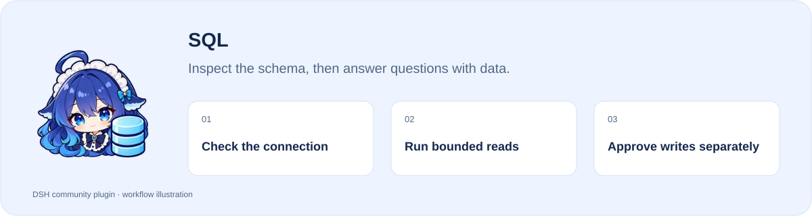

[简体中文](README.md) · **English**

# SQL

> **Inspect your schema first, then answer questions safely with bounded read-only queries and approval-gated writes.**

Database plugin for DeepSeek Harness (`>=0.2.2-rc.3`) supporting SQLite, MySQL, and PostgreSQL with a visual live Settings panel, one-click connectivity tests, engine-level read-only guards, column redaction, and explicit write approvals.

[](https://www.npmjs.com/package/dsh-sql) [](https://www.npmjs.com/package/dsh-sql) [](https://www.npmjs.com/package/dsh-sql)

**[Features](#features) · [Install](#install) · [Get Started in 3 Steps](#get-started-in-3-steps) · [Full Guide](https://github.com/STARDUSTLC666/dsh-sql/blob/master/docs/USAGE.en.md)**

<picture>
  <source media="(prefers-color-scheme: dark) and (max-width: 640px)" srcset="https://raw.githubusercontent.com/STARDUSTLC666/dsh-sql/master/docs/assets/intro/workflow-en-mobile-dark.svg">
  <source media="(max-width: 640px)" srcset="https://raw.githubusercontent.com/STARDUSTLC666/dsh-sql/master/docs/assets/intro/workflow-en-mobile-light.svg">
  <source media="(prefers-color-scheme: dark)" srcset="https://raw.githubusercontent.com/STARDUSTLC666/dsh-sql/master/docs/assets/intro/workflow-en-dark.svg">
  
</picture>

## Features

| Pillar | Capabilities |
| :--- | :--- |
| **Multi-Engine & Cloud TLS** | Manage SQLite, MySQL, and PostgreSQL via form fields or `url` URIs (`?sslmode=` and full `ssl` modes); passwords stay masked or load from `DSH_SQL_PASSWORD_<NAME>` |
| **Batch Schema Discovery** | List tables and PG materialized views by `schema`/`pattern`; inspect up to 20 tables concurrently for columns, defaults, PG `enumValues`, comments, indexes & foreign keys |
| **Engine-Level Read-Only** | `sql_query` enforces SQLite `PRAGMA query_only` and MySQL/PG `READ ONLY` transactions (with PG cursor reuse & server timeouts), emitting GFM Markdown, CSV, or JSON |
| **Redaction & Write Locks** | Lock writes globally or per connection via `readOnly`, and mask sensitive fields live via `redactColumns` (`[REDACTED]`) |
| **Approval-Gated Writes** | `sql_exec` supports parameterized multi-statement scripts while showing target DB, bound `params`, SQL text, and `⚠️` risk warnings (`DROP`/`TRUNCATE`/unfiltered writes) before execution |

## Install

Open **Plugins** in the DSH desktop app and install `dsh-sql`, or use the CLI:

```bash
dsh plugin --profile desktop add dsh-sql
```

For the web profile, replace `desktop` with `web` and restart DSH. Requires DSH `>=0.2.2-rc.3`.

<a id="start-using-it"></a>
## Get Started in 3 Steps

1. **Add and test connections (applies live)**: Open **DSH Settings → SQL Databases** (also accessible via **Settings → Built-in Plugins → SQL** or **Plugins → SQL (`dsh-sql`)**), paste a `url` or fill host credentials, run one-click **Test / Test draft** connectivity checks, and toggle `readOnly` or `redactColumns` as needed.
2. **Explore schema first**: Run a health check and inspect table lists, columns, and foreign keys before querying live tables.
3. **Query safely, approve writes**: Read queries stay strictly bounded and read-only; writes display every statement and bound parameter in an approval card before running.

### Copy-Ready Prompts

- **Schema overview**: `Check my database connection health, list all tables with approximate row counts, and summarize how the core tables relate.`
- **Read-only CSV analytics**: `Inspect the orders and users columns first, then run a read-only query for order counts and revenue over the past 7 days by status as CSV.`
- **Careful update loop**: `Query order id = 42 first so I can verify the row, then run the update to mark it paid with confirmation, and re-query afterward.`

## Quick Troubleshooting Checklist

| Symptom | Likely Cause | Fix |
| :--- | :--- | :--- |
| Only `default (:memory:)` appears | No external database configured yet | Open **DSH Settings → SQL Databases** (or **Settings → Built-in Plugins → SQL** / **Plugins → SQL**), add & test your connection, and save (applies live) |
| `ECONNREFUSED` / `ETIMEDOUT` | DB server down, wrong host/port, or firewall | Verify host, port, and server status in **Settings → SQL Databases**, click **Test**, or re-run health check |
| TLS/SSL certificate error | Cloud DB requires TLS or self-signed cert rejected | Configure `ssl` / `?sslmode=` (or `{ rejectUnauthorized: false }` / `ca` path) |
| `Access denied` / auth failed | Incorrect credentials | Update password in **Settings → SQL Databases** (verify with **Test**) or set `DSH_SQL_PASSWORD_<CONNECTION_UPPER>` |
| Write blocked under `never` policy | Session blocks interactive approval cards | Switch to interactive (`ask`) mode, or enable `readOnly` for read-only workflows |

## Plugin updates

Check updates at the bottom of native plugin details. Automatic checks are on by default; **automatic installation is off**. Suite-managed components update with their bundle.

## Documentation & feedback

- [Usage guide](https://github.com/STARDUSTLC666/dsh-sql/blob/master/docs/USAGE.en.md) · [Full reference](https://github.com/STARDUSTLC666/dsh-sql/blob/master/docs/REFERENCE.en.md) · [Release notes](https://github.com/STARDUSTLC666/dsh-sql/blob/master/CHANGELOG.md) · [Validation history](https://github.com/STARDUSTLC666/dsh-sql/blob/master/docs/VALIDATION.md)
- Stars, [Issues](https://github.com/STARDUSTLC666/dsh-sql/issues), and [PRs](https://github.com/STARDUSTLC666/dsh-sql/pulls) are welcome (strip credentials first).

## License

[MIT](https://github.com/STARDUSTLC666/dsh-sql/blob/master/LICENSE)

<a id="what-it-does"></a>
<a id="requirements-and-configuration"></a>
